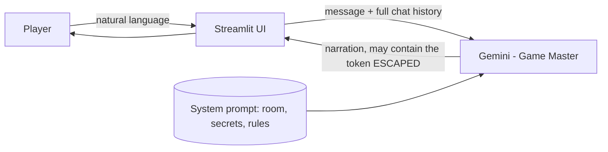
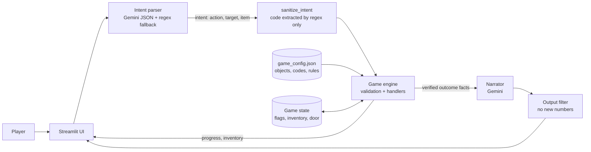

# Architecture

## Version 1 - LLM does everything

State, rules, solutions and win detection all live inside the LLM's context. Nothing is enforced.

## Version 2 - Python decides, LLM describes

Security boundaries: the parser LLM never sees the solutions; the narrator only sees the already-decided outcome;
the engine is the only code that mutates state; codes are never taken from LLM output.
